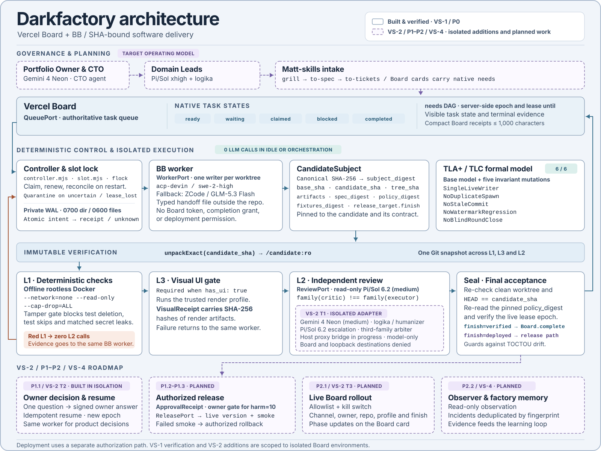

# Darkfactory

Darkfactory is a software delivery controller built on Vercel Board, BB, and Git. Board holds the task queue and its dependencies, BB runs the implementation worker, and Git identifies the exact candidate that the controller verifies. On the verified path, a card closes only after deterministic checks, independent review, and a final check of the candidate and its live claim.



The solid path shows the VS-1 / P0 baseline exercised on an isolated Board. Dashed components show the target operating model, isolated VS-2 implementations, and planned work.

## How a card reaches completion

1. **Admit and claim.** Vercel Board owns the `needs` dependency graph and the native `ready`, `waiting`, `claimed`, `blocked`, and `completed` states. The controller selects an eligible ready card using trusted route policy and acquires a native claim with a server-issued `epoch` and lease expiry `until`. The claim token stays with the controller.
2. **Assign one writer.** BB gives one worker a feature worktree. The primary route uses Devin SWE-2 High via `acp-devin`. ZCode Start with GLM-5.3 Flash is an approved fallback when quota is available, the primary has definitively refused, the worktree remains clean at its base SHA, and no background agents remain. The worker submits a typed handoff outside the repository, bound to its task, attempt, epoch, BB thread, and candidate SHA. Board completion and deployment authority stay outside the worker.
3. **Bind the evidence.** The controller hashes the canonical `CandidateSubject` to produce `subject_digest`. The manifest binds the base, candidate and tree SHAs, artifacts, specification, policy and fixture digests, and requested finish. Verification uses an exact Git snapshot from `unpackExact` mounted read-only at `/candidate`.
4. **Verify in gate order.** L1 runs trusted commands in rootless Docker with `--network=none`, `--read-only`, and `--cap-drop=ALL`. The tamper gate checks for test deletion, skips, weakened assertions, and recognized secret patterns. A failed deterministic check returns evidence to the same worker before any L2 call. L3 runs the visual profile when `has_ui` is true and records SHA-256 hashes of the render artifacts in a `VisualReceipt`. L2 uses a read-only critic from a different model family. The VS-1 review profile uses Pi/Sol 6.2 at medium effort.
5. **Seal the result.** Before `Board.complete` on the `finish=verified` path, the controller rechecks the clean worktree, exact `HEAD` and tree, pinned operator inputs and Board contract, and live claim epoch. This seal guards against drift between verification and completion. Board receives compact typed evidence of at most 1,000 characters. The private journal retains the full evidence.

The controller makes zero model calls during idle polling or orchestration. Its write-ahead log records intent before external effects and reconciles interrupted attempts against observable Board and BB state on restart. Atomic state writes use a private directory and files with modes `0700` and `0600`. A durable worktree reservation and a kernel `flock` prevent a second writer. A lost lease or ambiguous effect keeps the worktree quarantined until the previous writer can be accounted for.

## Run the checks

Use Linux with Node.js **22.18 or later**, npm, Git, and `flock`. The tests use the Vercel Board **0.54.0** SDK from the per-user runtime. The package manifest and lockfile are in [`ops/local/`](ops/local/).

On a fresh user account, install the pinned SDK into the runtime path expected by the tests.

```sh
runtime="$HOME/.local/share/vercel-board"
mkdir -m 700 -p "$(dirname "$runtime")"
mkdir -m 700 "$runtime" &&
  install -m 600 ops/local/package.json ops/local/package-lock.json "$runtime" &&
  npm ci --prefix "$runtime"
```

Run the suites from the repository root. Integration requires rootless Docker, the local `node:22.23.2-bookworm-slim` image, and a configured Pi/Sol installation for the live review case. The suite uses disposable Board instances. TLC requires Java and `tla2tools.jar`. For local runs, clear inherited proxy settings if they point to a loopback or private proxy, since the VS-1 review guard rejects those destinations.

```sh
npm test
TLA_TOOLS_JAR=/path/to/tla2tools.jar npm run test:tla
node ops/local/check-workspace-space.mjs build "${TMPDIR:-/tmp}"
TLA_TOOLS_JAR=/path/to/tla2tools.jar npm run test:integration
```

The published source was checked at commit `714cf06`. [Source revision](https://github.com/MyDum-bsu/darkfactory/commit/714cf06ddb146929301cd89bd37b106c189a0d5b)

| VS-1 baseline | Command | Evidence |
| --- | --- | --- |
| Unit | `npm test` | **255/255** passed on the published source. |
| Integration | `npm run test:integration` | **22/22** reported for VS-1. Publication checks reran **21/21** integration cases, omitting the live Pi/Sol case. |
| Formal model | `npm run test:tla` | **6/6** on the published source. The bounded base model passed over 24,701 distinct states, and each of the five deliberate mutants violated its expected invariant. |

The modeled invariants are `SingleLiveWriter`, `NoDuplicateSpawn`, `NoStaleCommit`, `NoWatermarkRegression`, and `NoBlindRoundClose`. The isolated VS-1 end-to-end run also recorded a red L1 with zero L2 calls, an L2 rework verdict, eventual acceptance, native release of a dependent card to `ready`, and an idle tick with zero model calls.

`npm run doctor` is a read-only check for an existing local installation. It compares the installed SDK and operator scripts with the pinned versions and checks Board reachability and BB CLI availability.

## Status and roadmap

| Milestone | Status | Scope |
| --- | --- | --- |
| VS-1 / P0 | Built and verified in isolation | Native claim and dependency handling, single-writer execution, restart reconciliation, same-worker rework, immutable verification, and sealed `finish=verified` completion. |
| VS-2 operating model | Target workflow | Portfolio owner, Gemini 4 Neon CTO agent, Pi/Sol domain leads at xhigh effort with `logika`, and `grill` → `to-spec` → `to-tickets` intake with native `needs`. |
| VS-2 T1 | Implemented on the isolated VS-2 branch | Gemini 4 Neon at medium effort is the primary critic. Trusted profiles attach `logika` or `humanizer`. Pi/Sol handles dispute arbitration as a third model family. The Neon request uses a fixed host API endpoint, and the model-only host proxy bridge for Pi/Sol is in progress. Live provider review has its own acceptance suite on the VS-2 branch. |
| VS-2 T2 / P1.1 | Built and exercised in isolation | One structured question, an Ed25519-verified owner answer, and idempotent resume under a fresh epoch. Product decisions resume the same worker. The isolated route depends on an exclusive Board writer because native unblock in Board 0.54.0 lacks an epoch precondition. |
| VS-2 T4 / P1.2–P1.3 | Planned | `finish=deployed` uses an `ApprovalReceipt`, an owner gate for `harm=10`, and a dedicated `ReleasePort` to an authorized target. The release path checks the actual live version and runs smoke tests, with authorized rollback if smoke fails. |
| VS-2 T3 / P2.1 | Planned | Live Board rollout through an explicit allowlist and kill switch, with phase updates on the task card. |
| P2.2 / VS-4 | Planned | Read-only observation, fingerprint-deduplicated incidents, and a factory memory and learning loop. |

## Source map

| Path | Responsibility |
| --- | --- |
| [`board_pipeline/controller.mjs`](board_pipeline/controller.mjs) and [`slot.mjs`](board_pipeline/slot.mjs) | Deterministic state transitions, effect reconciliation, and exclusive worktree reservation. |
| [`board_pipeline/native-board.mjs`](board_pipeline/native-board.mjs) and [`run-isolated.mjs`](board_pipeline/run-isolated.mjs) | Native Board adaptation and the isolated operator entry point. |
| [`board_pipeline/subject.mjs`](board_pipeline/subject.mjs), [`runtime.mjs`](board_pipeline/runtime.mjs), and [`acceptance.mjs`](board_pipeline/acceptance.mjs) | Candidate identity, exact snapshots, verification, and final settlement. |
| [`board_pipeline/review-runner.mjs`](board_pipeline/review-runner.mjs) and [`pi-guard.cjs`](board_pipeline/pi-guard.cjs) | Read-only review, evidence binding, and restrictions on review tools and egress. |
| [`specs/tla/`](specs/tla/) | Bounded controller model, invariant configurations, and TLC test harness. |
| [`ops/local/`](ops/local/) | Pinned Board SDK and versioned operator scripts for review, route selection, host launch, and disk preflight. |

Repository policy requires a scoped Board card, a single writer per feature worktree, and independent review of the exact clean SHA. Branch checks and explicit authorization govern protected release actions. Runtime state, credentials, model sessions, and build artifacts belong outside the repository.
