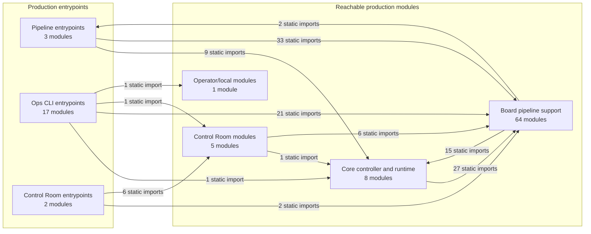

# Architecture Wiring Census

> Generated by `node ops/df-map.mjs --write-doc`. Do not edit manually; update the source wiring or the generator instead.

## Mermaid architecture diagram

The diagram aggregates cross-category static ESM edges so cycles and fan-out remain readable. The inventory below is the exact deterministic census; test files and `*-fixture.mjs` files are excluded from production counts.

## Wiring inventory

| Metric | Count |
|---|---:|
| Production modules scanned | 135 |
| Entrypoints | 22 |
| Wired production modules | 100 |
| Unwired production modules under `board_pipeline/` and `ops/` | 33 |
| `board_pipeline/` → `ops/` reverse leaks | 0 |
| Production files over 700 LOC | 18 |
| Static production graph edges | 317 |

### Entrypoints (22)

- `board_pipeline/daemon.mjs`
- `board_pipeline/run-isolated.mjs`
- `board_pipeline/run-release-watch.mjs`
- `ops/check-fleet.mjs`
- `ops/check-host.mjs`
- `ops/control-room/aggregator.mjs`
- `ops/control-room/df-herd.mjs`
- `ops/df-archive.mjs`
- `ops/df-board-setup.mjs`
- `ops/df-decisions.mjs`
- `ops/df-dream.mjs`
- `ops/df-explain.mjs`
- `ops/df-gh-sync.mjs`
- `ops/df-graduate.mjs`
- `ops/df-map.mjs`
- `ops/df-models.mjs`
- `ops/df-release-radar.mjs`
- `ops/df-sentinel.mjs`
- `ops/df-weekly-audit.mjs`
- `ops/factory-enqueue.mjs`
- `ops/factory-run.mjs`
- `ops/herdr/deploy-herdr.mjs`

### Wired production modules (100)

- `board_pipeline/ab-pilot.mjs`
- `board_pipeline/acceptance.mjs`
- `board_pipeline/adaptive-gates.mjs`
- `board_pipeline/agy-stream.cjs`
- `board_pipeline/agy-transport.mjs`
- `board_pipeline/baseline-cache.mjs`
- `board_pipeline/bb-reconcile.mjs`
- `board_pipeline/bb-stage-adapter.mjs`
- `board_pipeline/blast-radius.mjs`
- `board_pipeline/board-stigmergy.mjs`
- `board_pipeline/branch-drift.mjs`
- `board_pipeline/config-compiler.mjs`
- `board_pipeline/controller.mjs`
- `board_pipeline/daemon.mjs`
- `board_pipeline/decision-ledger.mjs`
- `board_pipeline/event-bus.mjs`
- `board_pipeline/field-mode.mjs`
- `board_pipeline/fs-safe.mjs`
- `board_pipeline/github-issues-mirror.mjs`
- `board_pipeline/herdr-spaces.mjs`
- `board_pipeline/holdout-runner.mjs`
- `board_pipeline/intake-prompt.mjs`
- `board_pipeline/l1-profiles.mjs`
- `board_pipeline/local-release.mjs`
- `board_pipeline/loop-detector.mjs`
- `board_pipeline/merge-queue.mjs`
- `board_pipeline/model-prompt-profiles.mjs`
- `board_pipeline/model-proxy.mjs`
- `board_pipeline/model-registry.mjs`
- `board_pipeline/model-scorecard.mjs`
- `board_pipeline/native-board.mjs`
- `board_pipeline/neon-review.mjs`
- `board_pipeline/owner-twin.mjs`
- `board_pipeline/pilot-gate.mjs`
- `board_pipeline/pilot-projection.mjs`
- `board_pipeline/playbook-router.mjs`
- `board_pipeline/project-memory.mjs`
- `board_pipeline/question-gate.mjs`
- `board_pipeline/question-resume.mjs`
- `board_pipeline/release-contract.mjs`
- `board_pipeline/release-flow.mjs`
- `board_pipeline/release-readback.mjs`
- `board_pipeline/release-target.mjs`
- `board_pipeline/release-watch-board.mjs`
- `board_pipeline/release-watch.mjs`
- `board_pipeline/review-policy.mjs`
- `board_pipeline/review-runner.mjs`
- `board_pipeline/review-setup.mjs`
- `board_pipeline/rework-distiller.mjs`
- `board_pipeline/role-registry.mjs`
- `board_pipeline/run-adaptive.mjs`
- `board_pipeline/run-isolated.mjs`
- `board_pipeline/run-release-watch.mjs`
- `board_pipeline/run-transport.mjs`
- `board_pipeline/runtime.mjs`
- `board_pipeline/scope-fence.mjs`
- `board_pipeline/scope-lock-scheduler.mjs`
- `board_pipeline/sdk.mjs`
- `board_pipeline/session-archive.mjs`
- `board_pipeline/signals.mjs`
- `board_pipeline/skill-picker.mjs`
- `board_pipeline/slot.mjs`
- `board_pipeline/stage-sandbox-transport.mjs`
- `board_pipeline/stage-verifier.mjs`
- `board_pipeline/subject.mjs`
- `board_pipeline/tamper-gate.mjs`
- `board_pipeline/taste-distiller.mjs`
- `board_pipeline/taste-profile.mjs`
- `board_pipeline/telemetry-collector.mjs`
- `board_pipeline/telemetry.mjs`
- `board_pipeline/unified-ledger.mjs`
- `board_pipeline/visual-captures.mjs`
- `board_pipeline/worker-runtime.mjs`
- `board_pipeline/worker-selector.mjs`
- `board_pipeline/workspace-budget.mjs`
- `ops/check-fleet.mjs`
- `ops/check-host.mjs`
- `ops/control-room/aggregator.mjs`
- `ops/control-room/board-observer.mjs`
- `ops/control-room/df-herd.mjs`
- `ops/control-room/finops.mjs`
- `ops/control-room/net-health.mjs`
- `ops/control-room/origin-guard.mjs`
- `ops/control-room/telemetry-fleet.mjs`
- `ops/df-archive.mjs`
- `ops/df-board-setup.mjs`
- `ops/df-decisions.mjs`
- `ops/df-dream.mjs`
- `ops/df-explain.mjs`
- `ops/df-gh-sync.mjs`
- `ops/df-graduate.mjs`
- `ops/df-map.mjs`
- `ops/df-models.mjs`
- `ops/df-release-radar.mjs`
- `ops/df-sentinel.mjs`
- `ops/df-weekly-audit.mjs`
- `ops/factory-enqueue.mjs`
- `ops/factory-run.mjs`
- `ops/herdr/deploy-herdr.mjs`
- `ops/local/df-auto-update.mjs`

### Unwired production modules under board_pipeline/ and ops/ (33)

- `board_pipeline/agy-pre-tool.cjs`
- `board_pipeline/agy-tools.cjs`
- `board_pipeline/ci-healer.mjs`
- `board_pipeline/cmd-guard.mjs`
- `board_pipeline/dispatcher.mjs`
- `board_pipeline/loop-detector.cjs`
- `board_pipeline/model-proxy-client.cjs`
- `board_pipeline/model-scorecard-report.mjs`
- `board_pipeline/pi-guard.cjs`
- `board_pipeline/resource-steward.mjs`
- `board_pipeline/review-panel.mjs`
- `board_pipeline/submit.mjs`
- `board_pipeline/teamlead-runner.mjs`
- `board_pipeline/telemetry-report.mjs`
- `ops/ab-pilot-compare.mjs`
- `ops/ab-pilot-run.mjs`
- `ops/cloud-build/setup-triggers.mjs`
- `ops/control-room/action-gate.mjs`
- `ops/control-room/attempt-artifacts.mjs`
- `ops/control-room/server.mjs`
- `ops/control-room/web/app.js`
- `ops/factory-benchmark.mjs`
- `ops/factory-dispatch.mjs`
- `ops/herdr/df-herdr-telemetry.mjs`
- `ops/herdr/factory-map-v4.mjs`
- `ops/herdr/telemetry-parsers.mjs`
- `ops/jules-pilot/jules-triage.mjs`
- `ops/local/board-review.mjs`
- `ops/local/check-workspace-space.mjs`
- `ops/local/cmd-guard-hook.mjs`
- `ops/local/electron-app/main.cjs`
- `ops/local/import-owner-decisions.mjs`
- `ops/local/pick-personal-worker.mjs`

### Reverse leaks (0)

_None._

### Production files over 700 LOC (18)

| File | LOC |
|---|---:|
| `board_pipeline/acceptance.mjs` | 1908 |
| `board_pipeline/cmd-guard.mjs` | 932 |
| `board_pipeline/controller.mjs` | 1185 |
| `board_pipeline/pi-guard.cjs` | 756 |
| `board_pipeline/project-memory.mjs` | 1325 |
| `board_pipeline/resource-steward.mjs` | 755 |
| `board_pipeline/review-runner.mjs` | 1520 |
| `board_pipeline/run-isolated.mjs` | 1261 |
| `board_pipeline/runtime.mjs` | 722 |
| `board_pipeline/session-archive.mjs` | 973 |
| `board_pipeline/tamper-gate.mjs` | 737 |
| `board_pipeline/telemetry-collector.mjs` | 1520 |
| `board_pipeline/worker-selector.mjs` | 1038 |
| `ops/control-room/aggregator.mjs` | 785 |
| `ops/control-room/finops.mjs` | 783 |
| `ops/control-room/telemetry-fleet.mjs` | 1122 |
| `ops/control-room/web/app.js` | 1244 |
| `ops/factory-benchmark.mjs` | 925 |
